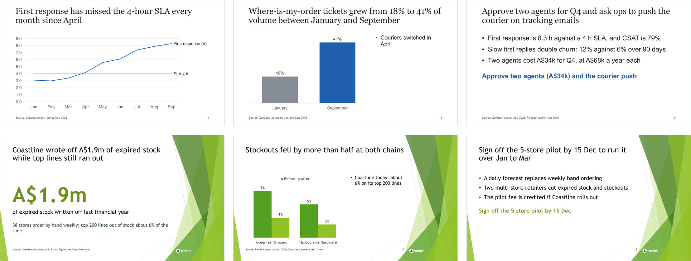

<div align="center">

# deck-builder

**PowerPoint decks from Claude that pass measured checks, not an eyeball.**

A [Claude Code](https://code.claude.com/docs/en/overview) skill that turns your notes and data into editable .pptx decks:
a story you can follow from the titles alone, text measured to fit in PowerPoint, font floors, contrast,
alt text and sourced numbers, in a clean default theme or your company's own template.

[](https://github.com/coffeedroplabs/deck-builder/actions/workflows/ci.yml)
[](LICENSE)
[](#install)
[](#requirements)



<sub>Top: a support review in the default theme. Bottom: a sales pitch built inside a company's .potx template.<br>
Every slide is native PowerPoint: editable text, real charts with their data, no pictures of text.</sub>

</div>

## Why

Ask a model for slides and it writes the XML, guesses where the text fits and tells you the deck looks
great. It cannot see the deck. Text runs out of its box, labels collide, titles name a topic instead of
making a point, the template's logo vanishes under a chart, and a round "40% faster" turns up that is
nowhere in your material.

deck-builder takes the guessing out. Claude writes a JSON spec, a deterministic builder lays it out from
locked layouts, PowerPoint itself measures every text box, and a lint writes the verdict to
`gate_result.json`. Claude is told not to call a deck finished unless that file says it passed.

## What you get

- **The story first.** Before a single slide is built you see the *ghost deck*: the titles alone, in
  order. Each one is a claim ("Customer satisfaction fell from 91% to 79%"), not a topic ("Customer
  satisfaction"). You approve or change it in chat.
- **Text that really fits.** Every text box is laid out and measured by PowerPoint. The builder refuses
  a slide rather than shrink type below the floor or let it overflow, and names the slide and field to fix.
- **Three profiles.** `live` for a room or a call (18 pt floor, at most 4 bullets, speaker notes on
  every content slide), `pitch` for presented-then-sent (16 pt floor) and `read-ahead` for decks read
  alone (more detail, a source line on every data slide).
- **Native, editable output.** Real PowerPoint charts with their data embedded (bar, column, stacked,
  line, pie, waterfall, scatter), real tables and the real title placeholder. No SmartArt, effects or
  embedded fonts, the things that cause repair prompts.
- **Your template, kept intact.** Give it a .pptx or .potx. It reads the layouts, maps each slide type
  to one, and the lint fails any slide whose content covers the template's logo or artwork.
- **Numbers you can stand behind.** Charts, tables and quantities carry a source line, and Claude is
  told never to invent, round or estimate a figure.
- **Accessibility built in.** WCAG 2.2 contrast (4.5:1 for text, 3:1 for chart marks), alt text on
  every picture, chart and table, and a font floor for each profile.
- **An independent review.** Once the gate passes, a blind reader who sees only the slide pictures and
  three critics look for what scripts cannot: a chart that does not show what its title claims, a
  number that does not match its source, a deck that reads as generic.

## Install

In Claude Code:

```
/plugin marketplace add coffeedroplabs/deck-builder
/plugin install deck-builder@deck-builder
```

Or clone it into your personal skills folder:

```bash
git clone https://github.com/coffeedroplabs/deck-builder ~/.claude/skills/deck-builder
```

Use one or the other, then start a new Claude Code session.

### Requirements

| Needs | Why |
|---|---|
| [uv](https://docs.astral.sh/uv/getting-started/installation/) | Runs every script with its pinned dependencies (python-pptx, Pillow). Nothing is installed globally, and uv fetches Python 3.11 or newer if you do not have it. |
| Linux, macOS or WSL | Native Windows is not supported yet: the render lock uses `fcntl`. |
| PowerPoint on Windows, reached from WSL | For measured fit, the heart of the skill. Without it, renders fall back to LibreOffice (`soffice` and `pdftoppm`), which draws the slides but cannot measure them, so overflow is predicted from font metrics and the lint says so. PowerPoint for Mac is not driven. The LibreOffice path is untested. |
| Fonts, on Linux and WSL | `fontconfig fonts-liberation fonts-dejavu-core fonts-crosextra-carlito fonts-crosextra-caladea`, the metric-compatible stand-ins for Arial, Calibri and Cambria that the builder measures with. |

## Use it

Just ask. The skill picks up any request for slides, a deck or a .pptx:

> I've got 15 minutes at Thursday's ops meeting to present the Q3 support review and ask for two more
> agents. It'll be on the big screen. Can you make the slides from my notes and the Zendesk export?

> Make the H1 board pack from the memo and the financials. The board reads it on their own a week
> before the meeting.

> Turn my pitch notes into a deck in our company template (fernhill.potx). We present it on their
> screen and then send it to them afterwards.

Claude asks only for what it cannot find in your files (the audience, the ask, how the deck will be
used), shows you the ghost deck, and builds once you approve it. You get the .pptx, a contact sheet
of every slide, the gate result with any warnings it kept and why, and what the review changed.

## How it works

1. **Brief.** Profile, audience and the ask, material, template and length, written to `brief.md`.
2. **Outline and your yes.** Titles only, in `outline.json`. `check_story.py` checks them and prints
   the ghost deck for you to approve.
3. **Spec.** `deck.json` gives each slide a layout (statement, bullets, two-column, chart, table,
   image, big-number, quote, process or conclusion) and its content. Never coordinates.
4. **Build.** `build_deck.py` fits every text at the profile's sizes and writes the .pptx, or refuses
   and names the slide, field and reason.
5. **Render and measure.** `render.py` opens the deck in PowerPoint, read-only and without a window,
   exports every slide and measures each text box's real bounds and line count. It never touches the
   decks you have open.
6. **Lint.** `lint_deck.py` checks measured overflow, overlap, the safe area, font floors, contrast,
   alt text, leftover placeholder text, filler words, em dashes and the story, then writes
   `gate_result.json`.
7. **Review.** A blind reader, then three critics, never more than three agents at a time.
8. **Fix ladder.** Cut words, move detail to the notes or an appendix, split the slide, change the
   layout. Never shrink the text, never edit the .pptx by hand. Then back to step 4.

Here is the ghost deck `check_story.py` printed for the support review above:

```
Ghost deck: read only the titles. They should carry the whole argument.

  1  cover       Support is missing its 4-hour SLA and needs two more agents in Q4
  2  chart       Monthly tickets rose from 1,820 in January to 2,840 in September
  3  chart       Where-is-my-order tickets grew from 18% to 41% of volume between January and September
  4  chart       First response has missed the 4-hour SLA every month since April
  5  chart       Customer satisfaction fell from 91% to 79% between January and September
  6  chart       Customers waiting over 24 hours for a first reply churn at double the 90-day rate
  7  two-column  Macros and a weekend rota helped but did not fix weekday backlogs
  8  table       We recommend hiring over a three-month chatbot build or per-ticket outsourcing
  9  conclusion  Approve two agents for Q4 and ask ops to push the courier on tracking emails

9 slides, 0 warning(s). Show the user this ghost deck and ask them to approve or change the titles.
```

And the verdict once that deck was built, rendered and linted:

```
PASSED: 0 error(s), 0 warning(s), text measured in PowerPoint, outline approved. Verdict: gate_result.json
```

### The scripts

They live in `scripts/` and run on their own too. Each prints what to do next, writes a JSON report,
and exits 0 when all is well, 1 for a problem to fix in the spec and 2 for a crash or unreadable input.

| Script | Does |
|---|---|
| `check_story.py outline.json` | The story gate, on the titles alone. `--approve --by "user, in chat"` records your approval |
| `inspect_template.py brand.potx` | Reads a company template and suggests how to map its layouts |
| `build_deck.py deck.json -o deck.pptx` | Checks the spec, fits every text and builds; refuses rather than shrink or overflow |
| `render.py deck.pptx -o render/` | Renders PNGs and a contact sheet, and measures every text box in PowerPoint |
| `lint_deck.py deck.pptx --spec deck.json` | The gate: writes `gate_result.json` |

```bash
uv run -q scripts/build_deck.py deck.json -o deck.pptx
```

### Rules it never trades away

- No invented numbers. Every figure is in your material or carries a source line.
- No text in images, no emoji, no Markdown on slides, no em dashes.
- No "Thank you" or "Questions?" slide. The deck ends on the conclusion and the ask, which stays up
  during questions, so it carries the decision, the cost and the date on its own.
- No grids of big-number tiles: they are where made-up round figures hide.
- The gate's verdict is not Claude's to override. If a rule is wrong for your deck, Claude says so
  instead of working around it.

### Where the thresholds come from

Every threshold lives in `scripts/themes.py`, and `references/design-rules.md` grades the evidence
behind each one. The 18 pt floor and the 4-bullet limit are strong (Kosslyn et al. 2012, plus UK ONS
and Microsoft guidance), as is contrast (WCAG 2.2). Direct chart labels and claim titles are moderate:
one study each. The 15-word title limit and the read-ahead sizes are weak, conventions only, so they
are warnings. Popular rules with no evidence behind them, such as 10/20/30 and 6x6, are not used.

## Results

Three eval cases, each run once with the skill and once without it, with the same model (Claude Opus
5.5), prompt and files. Each case has 10 checks: the deck opens in PowerPoint, nothing overflows when
PowerPoint lays it out, small text stays in the footer, nothing collides, charts are native, titles
are claims, every number matches the material and carries a source, and the ask is right.

| Case | With deck-builder | Without | What the deck without the skill missed |
|---|:-:|:-:|---|
| Support review, presented live | **10/10** | 8/10 | Text overflowed its boxes in PowerPoint; the closing slide's figures had no source line |
| Board pack, read alone | **10/10** | 9/10 | Two slides with figures had no source line |
| Pitch in a company template | **8/10** | 6/10 | 14 pt text above the footer, two topic titles, unsourced figures, an ask without its price |
| **Mean** | **93%** | **77%** | |

The with-skill pitch failed two checks too: plain counts and dates went without a source, and the
pilot's price was not in the final ask.

The cost is time. Runs with the skill took about 4.3 times as long (302 s against 70 s on average) and
used 1.6 times the tokens (115k against 71k). Part of the time gap is queuing, because the runs
shared one PowerPoint render lock.

Read these numbers with care:

- One run per configuration over three cases is a small sample, not a benchmark.
- Both configurations passed opening in PowerPoint, no collisions, native charts and number accuracy.
  Claude is already good at those; the skill earns its keep on measured fit, sources, titles and the ask.
- Three fixes landed after the runs and have not been re-run: the template statement footer, what the
  ask must carry, and bar axes starting at zero.
- Scripts graded what they could; the author's own agent graded the rest, not blind.

## Limitations

- The lint does not catch plain counts and dates without a source ("5 stores for 12 weeks"), only
  money, percentages, multipliers, decimals and thousands. The skill tells Claude to source them
  anyway, and the eval above shows it does not always.
- Line charts labelled at every point can put labels on the line.
- Slides with little content sit at the top of the body instead of the middle.
- A bullet whose last line is a single word is not flagged.
- `two-column` has no way to highlight the winning side.
- Template mode has no wide layout to map to.
- Chart fills in a light accent colour are not shaded darker.
- Builds spend 3.5 to 5.5 s scanning system fonts.
- Changing any title after approval means approving the ghost deck again.
- Measured fit needs PowerPoint on Windows. Elsewhere you get LibreOffice pictures and predicted fit,
  an untested path. Keynote and Google Slides are untested too.
- It builds new decks. To read, extract from or lightly edit a deck someone else made, use
  Anthropic's `pptx` skill.

## Repository layout

```
SKILL.md          the skill: workflow, rules, and when to read each reference
scripts/          story check, template inspector, builder, renderer and lint (PEP 723 inline deps)
references/       the spec format, design rules and their evidence, template mode, review, compatibility
reviewers/        prompts for the blind reader and the critics
evals/            three eval cases in the `claude plugin eval` format
tests/            unit and end-to-end tests
.claude-plugin/   plugin and marketplace manifests
```

## Development

On Linux, install the fonts first:

```bash
sudo apt-get install fontconfig fonts-liberation fonts-dejavu-core fonts-crosextra-carlito fonts-crosextra-caladea
```

Then:

```bash
uv run -q tests/run_tests.py -q                          # the suite; the PowerPoint test is skipped
DECK_BUILDER_RENDER=1 uv run -q tests/run_tests.py -q    # adds it, on WSL with PowerPoint
uvx ruff@0.15.0 check scripts tests
claude plugin validate . --strict
```

The eval cases run with `claude plugin eval . --scaffold --allow-tools Bash Write Edit --runs 1`. They
are slow (up to 40 minutes a case), spend your own Claude usage, and need PowerPoint for the measured
checks.

## Contributing

Issues and pull requests are welcome. A bug report helps most with the `deck.json`, the script's output
and `gate_result.json`. To change a threshold or add a rule, say where it comes from:
`references/design-rules.md` grades every rule by its evidence, and new ones should be graded the same
way. Run the tests, ruff and the plugin validator before opening a pull request.

## License

[MIT](LICENSE) © CoffeeDrop Labs Pty Ltd.

The eval fixture `evals/template-pitch/files/fernhill.potx` is a template for a fictional company. Its
design is PowerPoint's built-in Facet theme, which belongs to Microsoft and is not covered by this
license.
